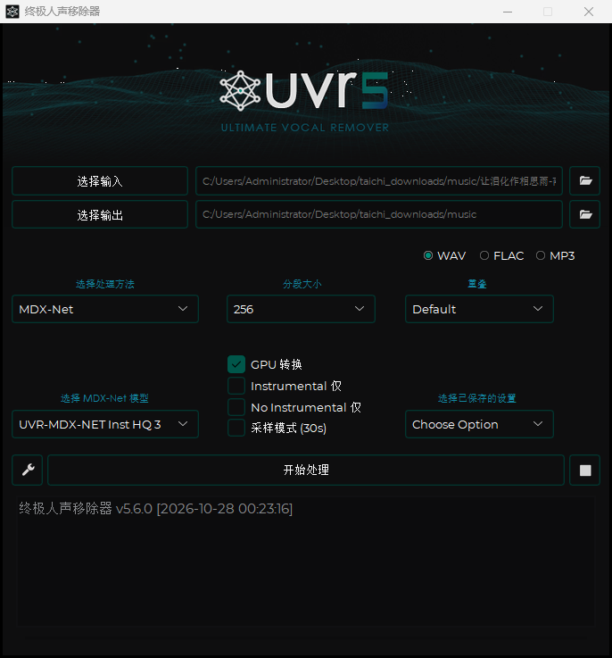

# UVR5 简体中文汉化工具链

给 **Ultimate Vocal Remover 5.6.0**（PyInstaller 打包的 Windows 单文件 exe）做简体中文界面汉化的完整工具链：从归档结构解析、字符串常量筛选，到重写打包与结果校验。

仓库只包含**工具与翻译表**，不包含原版程序本体（原 exe 及 5 GB 依赖见下文"使用"）。



## 成果

| 指标 | 数值 |
|---|---|
| 字符串替换总数 | **678** 处 |
| └ PYZ 模块 | 547（`UVR` 131 + `gui_data.constants` 416） |
| └ 入口脚本 | 131（CArchive 里的 `UVR` 根脚本） |
| 翻译表条目 | 522 条（`tr_labels1/2/3.json` 合并去重后） |
| 保留英文的排除项 | 10 条（路径类字符串，见 `tr_exclude.json`） |
| 英文对照构建改动数 | **0**（证明补丁只命中翻译表里的字符串） |

窗口标题被替换为 `终极人声移除器`，主界面所有分区标题、按钮、提示、下拉项均为中文。

汉化前后对比（英文对照构建 vs 中文构建）：`docs/en-window.png` / `docs/zh-window.png`

## 原理

PyInstaller 单文件 exe = bootloader + **CArchive**（内含 `.pyz` 压缩包）。汉化在字节层面重写 Python 字节码对象里的字符串常量，不反编译、不改逻辑：

1. `patch_build.load_carchive()` — 从文件尾向前找 cookie 魔数 `MEI\x0c\x0b\x0a\x0b\x0e`，解析 88 字节 footer 与 TOC，得到每个条目的位置/压缩标志/类型。
2. 取出 `.pyz` 条目 → zlib 解压 → 读 PYZ 头（`PYZ\0` + 4 字节 magic + TOC 偏移）→ `marshal` 反序列化 TOC。
3. 只处理 `patch_targets.json` 列出的模块（`UVR`、`gui_data.constants`），`marshal.loads` 得到 code object。
4. `patch_code()` 递归遍历 `co_consts`（含嵌套 code object、tuple / list / set / dict 内部字符串），按翻译表替换：
   - 精确匹配优先；
   - 若整串全大写（如 `CHOOSE PROCESS METHOD`），再以大写键查一次，长度 < 4 的忽略；
   - `co_consts` 用 `code.replace(co_consts=...)` 重建，未命中的字符串保持原对象不变。
5. 重新 `marshal.dumps` + zlib level 9 压缩，重建 PYZ：**保留原始数据区起始偏移**（该版本 PYZ 头 12 字节 + 5 字节 padding，从 offset 8 重排会把正文压到 padding 上并损坏第一个条目）。
6. 重建 CArchive：条目相对 overlay 的偏移基准不变，cookie 最后写入，Python 版本字段（309 → 3.9）原样保留。
7. CArchive 里的 **`UVR` 根脚本**与 PYZ 里同名模块是两回事，也要单独 patching（`decode_root_blob()` 兼容老式 pyc 头）。

## 文件

| 文件 | 说明 |
|---|---|
| **`patch_build.py`** | **核心构建脚本**：解析 CArchive/PYZ，替换字符串常量，重新打包输出 exe |
| **`verify_patch.py`** | **断言式校验**：结构、模块顺序、逐字符串比对，见下节 |
| `tr_labels1.json` `tr_labels2.json` `tr_labels3.json` | 中文翻译表（3 = 分区标题） |
| `tr_labels_en.json` | 英文恒等映射表，用于构建对照版 |
| `tr_exclude.json` | 必须保持英文的字符串（路径/标识符） |
| `patch_targets.json` | 需要重写的 PYZ 模块清单 |
| `language.json` | 无参构建时的默认语言 |
| `patch_report_zh_CN.json` `patch_report_en.json` | 构建产物报告（替换数、模块分布、体积） |
| `risk_scan.py` `risk_scan.json` | 扫描"既用于显示又参与比较/路径"的危险字符串 |
| `analyze.py` `tr_candidates.py` `tr_audit.py` | 反编译分析：区分显示用字符串与逻辑用字符串，产出候选表 |
| `name_context_check.py` `context_check.py` `final_candidates.py` `final_filter.py` `filter_candidates.py` `refine.py` | 候选筛选与上下文核对 |
| `inventory.py` `dump_pyc.py` `dump_name_use.py` `extract_pyz.py` `pyinstxtractor.py` | 归档结构清点、PYZ 导出、名字引用追踪 |
| `path_risk.py` | 排查"程序能否从该路径运行"（非 ASCII 路径风险） |
| `runtime_check.ps1` `title_check.ps1` `shot.ps1` `dialog_text.ps1` | 运行时验证：读窗口标题、读控件文本、截图 |
| `launch_with_tcl.ps1` | 预设 `TCL_LIBRARY` 的启动试验脚本 |
| `find_uninstall.ps1` `remove_uninstall_entry.ps1` `uninstall_entry_backup.reg` | 清理安装残留时用的注册表脚本与备份 |

## 使用

需要 **Python 3.9**（PYZ 内的字节码 magic 是 3.9；3.10+ 的 `marshal` 无法读写该版本 code object）。

```bash
# 构建
py -3.9 patch_build.py UVR_zh_CN.exe zh_CN

# 校验
py -3.9 verify_patch.py UVR_zh_CN.exe zh_CN
```

`patch_build.py` 里的 `SRC_EXE` 指向**未修改的原版 exe**（原始开发时是 `E:/UVR5/UVR.exe`）。原版现在随整个应用放在纯英文路径下，例如 `D:/UVR5_zh_CN/UVR.exe`，重建前请把 `SRC_EXE` 改成实际位置。`verify_patch.py` 复用同一个 `SRC_EXE` 做逐字符串比对。

### verify_patch.py 的断言

- CArchive 条目名列表、类型列表不变；输出仍以 `MZ` 开头；Python 版本字段仍是 309。
- PYZ 模块列表与顺序不变；每个模块的字符串常量**个数**不变。
- 每个变化过的字符串，要么在翻译表里且值完全一致，要么一字未改 —— 不允许出现"表外改动"或"改错值"。
- `zh_CN`：`tr_labels3.json` 里的分区标题不再有英文残留；`tr_exclude.json` 的条目确实保持英文；常量里确实出现中文；替换数 > 0。
- `en`：不含任何中文字符；替换数 == 0。
- 构建报告里的替换数与实际文件一致。

任何一条不成立即退出码 1。

## 已知限制

1. **运行路径必须纯 ASCII。** exe 用 ANSI 接口写 `TCL_LIBRARY` / `sys._MEIPASS`，路径含非 ASCII 字符（例如 `E:\中文目录\...`）会被写成 `???`，导致 `init.tcl` 找不到、或 `Error loading Python DLL ... LoadLibrary: 找不到指定的模块`。这正是最终把整个程序放在 `D:\UVR5_zh_CN` 的原因 —— 目录名、盘符之后的所有层级都要是英文。
2. **只改显示用字符串常量**，不改任何逻辑、比较分支或文件路径；同时被用于比较的字符串一律进 `tr_exclude.json` 保持英文。
3. 不翻译资源文件、模型名、第三方库内部的文本。

## 版权

Ultimate Vocal Remover 本体由 Anjok07 等人开发并以 MIT 许可发布；本仓库只提供汉化工具与翻译表，不包含原版程序。修改与再分发请遵守原项目许可证。
